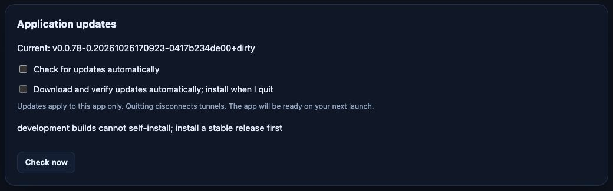

# Client updates

`ntwire` and `ntwire-gui` update independently from stable GitHub Releases.
Servers, relays, container images, and package manager deployments keep their
existing upgrade procedures. Only the existing release platforms are supported:
CLI on Linux/macOS/Windows amd64 and arm64; GUI on Linux/Windows amd64 and arm64
and macOS arm64.

## CLI

```sh
ntwire update --check
ntwire update
ntwire update --yes
```

`--check` displays the current/latest version and release notes without downloading.
`update` asks for confirmation in a terminal; `--yes` permits unattended use.
Neither triggers privilege prompts. If the destination requires administrator
access, use your package manager, move the standalone installation to a writable
location, or rerun the explicit command in an administrator terminal. On Windows,
a helper installs after the command exits; its result-file path is printed.
Development and prerelease builds can check manually but cannot self-install.
Equal/older releases are ignored; prereleases are never selected.

## GUI

Settings includes **Check now**, automatic-check and automatic-update preferences,
release notes, progress, errors, and **Quit and install**. The tray indicates when
an update is available or ready. Automatic checks default to enabled; automatic
download/installation defaults to disabled. A stable build checks asynchronously
at startup if the last successful check is older than 24 hours, then checks daily
while running. Preferences are saved in `gui.yaml`:

```yaml
settings:
  update_checks_disabled: false
  automatic_updates: false
```

Enabling automatic updates downloads and verifies in the background. A manual
**Download update** also prepares installation for the next orderly quit. The
running application is never replaced. **Quit and install** warns that tunnels
will disconnect, closes connections and settings-window processes, and exits.
The helper waits for exit and installs without relaunching. A normal tray quit
also installs a prepared update when the target is writable. An interruption
leaves the current application usable; completed downloads can be resumed from
the private cache on the next launch. Partial downloads are discarded and retry
from the beginning. Disabling automatic checks does not disable manual checks;
automatic downloads happen only following a successful check.

Administrator-only installations remain staged until the user chooses
**Authorize administrator install and quit…**. That explicit action invokes the
OS authorization dialog (UAC on Windows, AppleScript administrator authorization
on macOS, polkit/pkexec on Linux). Cancellation leaves the GUI running. Background
checks, downloads, and normal quits never request administrator access. A system
without the corresponding elevation tool reports the error in Settings. Unix
elevation executes the installed application image; Windows copies the helper
into a protected Program Files directory and checks its original-image hash
before executing it with administrator rights.



The screenshot shows a development build: manual discovery is available, but
installation is disabled. A production build also needs the verification key
provisioned as described below.

## Installation and recovery

Supported installations are writable standalone executables and complete macOS
`ntwire-gui.app` bundles. Keep the distributed executable/bundle name. Homebrew,
Scoop, Chocolatey, Nix, Snap, Flatpak, and recognized dpkg/RPM/pacman-owned paths
are directed to their package manager. Translocated macOS apps must first be
moved to Applications. Unsupported or read-only paths report the limitation.

Downloads, signed release evidence, successful-check timestamps, and helper
results are separate from configuration, in the user's OS cache directory under
`ntwire/updates/<installation-and-config-id>` (CLI uses a temporary cache).
Directories/files are private to the account. Profiles, credentials, CLI config,
launch arguments and autostart registrations are untouched. Installations are
serialized with a `<target>.update-lock` directory. A stale lock after a forced
termination requires checking that no helper is running before removing it.

The helper re-verifies signatures, size, and hashes, copies to a private staging
directory on the destination filesystem, hashes that snapshot again, and safely
extracts. It renames the old application to `<target>.previous-<old-version>`, then
activates the staged application. A replacement failure restores the previous
installation; if restoration also fails the error names the retained recovery
path. Previous versions are retained until the operator removes them. If a backup
with the same name already exists, installation stops rather than overwriting it.
After a failed installation, reopen the GUI to see the helper error, or read the
CLI helper's printed result path. A forced termination between the two renames can
require restoring the retained previous copy manually. This is not a post-launch
health rollback; test your tunnel connections after the next launch.

## Release signing setup

Production self-updates require operator provisioning. No signing key or trust
anchor is fetched from release metadata; an empty/unrecognized public key fails
closed. Existing installer `checksums.txt` remains available independently.

Generate a key **outside the checkout**, on a trusted machine:

```sh
go run ./scripts/update-manifest -generate-key /secure/location/ntwire-update.key
# Prints only the base64 public key; private file is created exclusively at 0600.
gh secret set NTWIRE_UPDATE_SIGNING_KEY < /secure/location/ntwire-update.key
gh variable set NTWIRE_UPDATE_PUBLIC_KEY --body '<printed-public-key>'
```

The secret contains the base64 64-byte Ed25519 private key. Store an offline
backup, restrict repository Actions/secret administration, and never commit it.
The public Actions variable is embedded with `-X .../pkg/updater.PublicKey=...`
in both release clients. Local builds may use the same linker option with the
public key; they must also carry a stable `pkg/buildinfo.Version` to self-install.

After GoReleaser uploads every client archive and the native macOS GUI job uploads
the complete `.app` archive, the final `update-manifest` job downloads the actual
published client archives. `go run ./scripts/update-manifest -version <version>
-dir <archives>` computes their sizes and SHA-256 hashes, requires every supported
client/platform combination, verifies the signing/public key match, signs the
exact UTF-8 `update-manifest.json` bytes, and uploads it and its detached base64
`update-manifest.sig` (signature last). A failed, missing, partial, or invalid
manifest makes that release unavailable. Never edit a signed manifest or replace
an archive afterward; rerun finalization if a release is rebuilt. Without both
provisioned values, the job emits a notice and publishes no update manifest.

For planned key rotation, publish a bridge release **signed by the old private
key** with binaries embedding the new public key, then sign later releases with
the new key. The workflow normally uses one public variable for both build and
signing consistency: prepare and verify the bridge artifacts with the new build
key and finalize the bridge manually with the old signing/public pair. Retain the
bridge for users who must install it explicitly: the latest-only updater cannot
skip directly from an old trust anchor to a new one. Announce that migration and
provide a manually verified installer path. On suspected private-key compromise,
stop publication and require an independently authenticated manual reinstall;
rotation alone cannot revoke an already compromised trust anchor.

## Validation and release acceptance

`go test ./pkg/updater ./internal/gui/updates ./scripts/update-manifest` exercises
signatures, complete releases, version/platform selection, corruption, traversal,
links/duplicate paths, cancellation/offline/rate limits, rollback, and a native
helper waiting for a real disposable executable process to exit. CI's
`updater-native` job runs those tests on Linux, Windows and macOS. API and manager
tests additionally exercise authentication, same-origin enforcement, settings and
concurrent requests. Run the full tests, race tests, vet, and command builds.

Before enabling production automatic updates, manually exercise each supported
OS on a disposable installation with a provisioned test release:

1. Check both products independently; verify notification-only defaults, manual
   confirmation, automatic download, and disabled checks after a restart.
2. Connect a tunnel, use Quit and install, cancel once, then accept. Keep a Settings
   window open, including one opened by a second launch. Verify orderly tunnel
   disconnect, window exit, complete app replacement and no automatic relaunch.
3. Launch again with the original arguments/autostart entry; verify version,
   profiles, credentials, CLI config, login registration, and actual connections.
4. Exercise a writable install and a protected directory: cancel authorization,
   then authorize explicitly; confirm background activity never prompts.
5. Interrupt downloads and helper activity; simulate permission/rename failure;
   verify recovery and the error shown on the next launch. Check offline/rate
   limiting and package-managed/read-only guidance.

Native CI configuration and cross-compilation do not establish this manual
quit/install/next-launch acceptance on each desktop OS, nor a live signed release.
